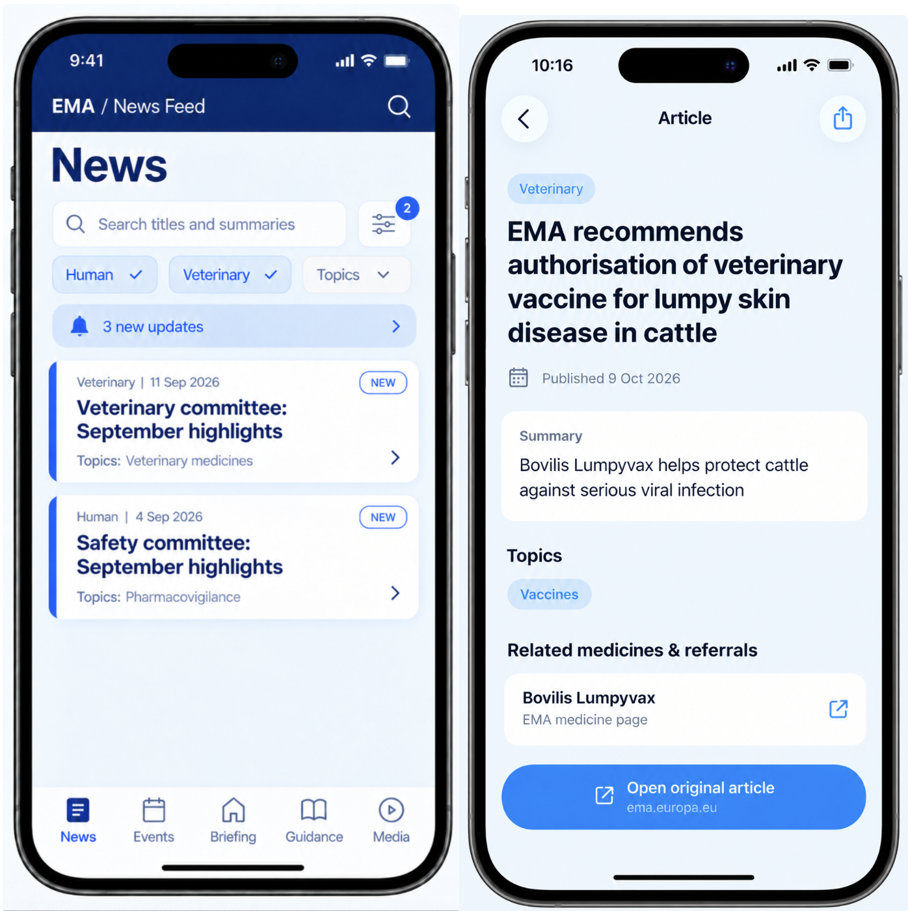
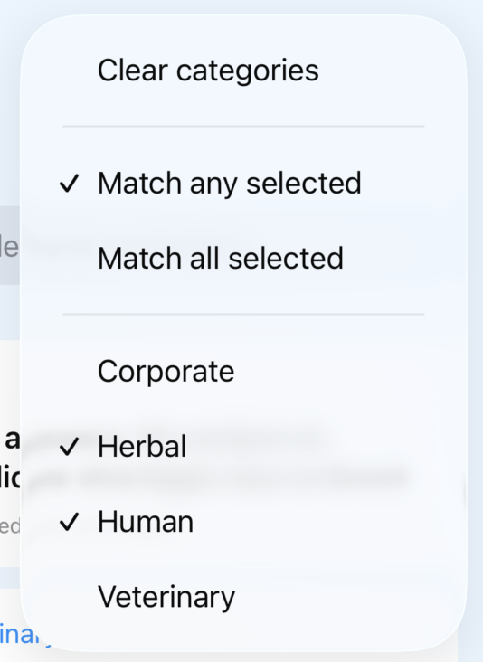
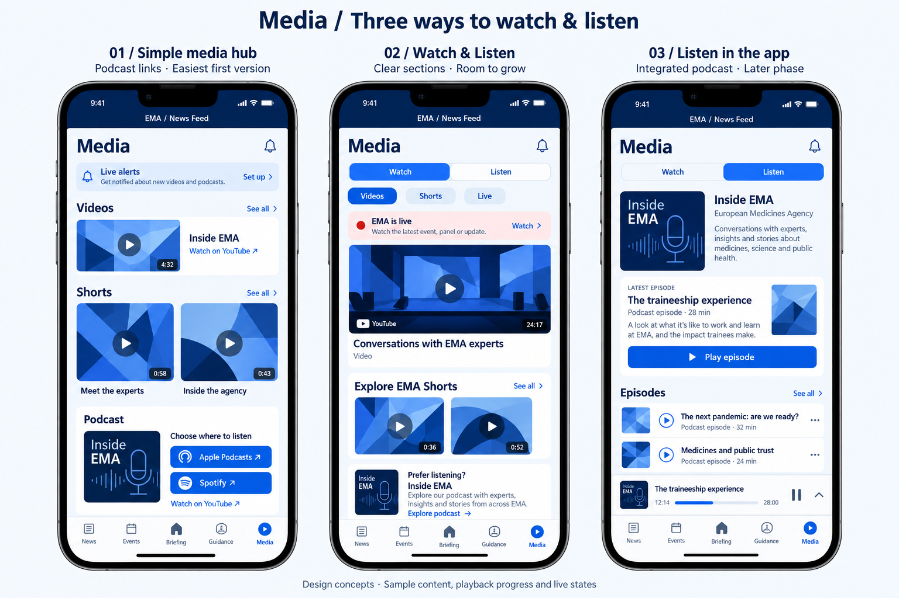
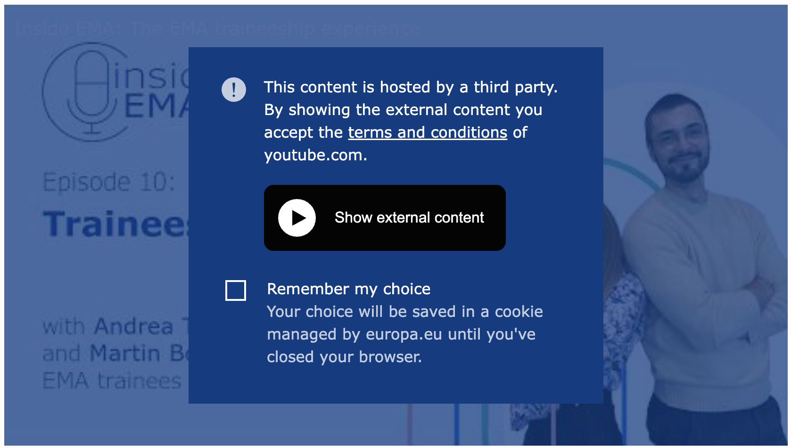
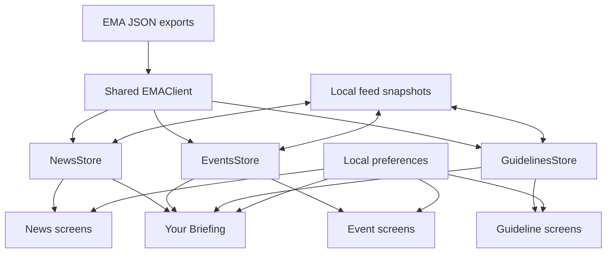

# EMA News Reader — App Description and Technical Design

## 1. Purpose and scope

EMA News Reader is an independent native iPhone app that makes public European Medicines Agency information easier to browse.

The main journey is:
**Open Your Briefing or a content tab → find a relevant item → read the available information → follow the original EMA source.**

Intended readers include regulatory affairs professionals, students, and anyone following medicines regulation. These audience groups are assumptions rather than findings from user research.

The app organizes published information. It does not provide clinical advice, replace original regulatory documents, or represent EMA.

### First-release scope

The app has five tabs:

1. News
2. Events
3. Your Briefing
4. Scientific Guidelines
5. Media

Your Briefing is the initial destination and occupies the central tab.

The first release focuses on browsing, searching, filtering, local reading history, and offline access to downloaded metadata. Accounts and cross-device synchronization are outside the initial scope.

## 2. Navigation and shared behavior

News, Events, and Scientific Guidelines each provide a browsing view and item details. Detail screens display the information available in the relevant export and offer a link to the original EMA page.

Your Briefing presents selected content from the same underlying feeds. It does not maintain separate copies of articles or independent reading history.

Opening an item from Your Briefing has the same effect on its reading state as opening it from its dedicated tab.

Switching tabs preserves loaded content and does not itself trigger another download.

Original-source links open in the user’s browser. Returning to the app preserves the previous screen, filters, and position where practical.

## 3. Features by tab

### 3.1 News

The News tab displays EMA news as cards.

#### Cards and details

Each card shows:

- Title
- First publication date
- Categories
- Topics
- Applicable reading and change badges

The detail screen shows:

- Title and summary
- Publication and update dates, where available
- Categories and topics
- Press-release status
- Related medicine or referral names, where available
- An action to open the original EMA page

Related medicine and referral names are initially displayed as text. Linking those names to individual EMA pages remains an open decision.



#### Search

- Search matches article titles and summaries.
- Leading and trailing whitespace is ignored. Matching is case- and diacritic-insensitive.
- Search text does not persist between launches.

#### Categories and topics

Filter options come from values present in the downloaded news feed. 

Each filter group supports multiple selections and two matching modes:

- **Match any selected:** the article contains at least one selected value.
- **Match all selected:** the article contains every selected value.

The default mode is **Match any selected**. An empty selection leaves that group unrestricted.

Search, category filters, and topic filters combine with AND: an article must satisfy all three groups.

For example, selecting Human and Veterinary with “Match any selected” includes articles tagged with either category. Switching to “Match all selected” requires both categories. Selecting a topic narrows those results further.

Filter menus remain open while selecting multiple values.

Category and topic selections, including their matching modes, persist between launches.

The count on each filter button indicates the number of selected values, not the number of matching articles.

Each group has its own clear action.

A “Clear all filters” action clears search, categories, and topics and restores the default matching modes.

Saved selections may no longer appear in a later export. Such selections remain visible and removable rather than silently restricting results.




#### Sorting and counts

Sort by first publication date, newest first, with a stable tie-breaker for items sharing a date.

A NEW count above the list reflects only articles matching the current search and filters.

An alternative sort by most recently updated is a possible enhancement.

### 3.2 Events

The Events tab offers Calendar and List views.

**Proposed default:** Show upcoming and ongoing events. Users can enable past events.

Upcoming events are ordered by their next relevant start time, nearest first. Ongoing events remain visible until they end.

#### Calendar view

- Dots indicate dates containing events.
- Selecting a date displays its events below the calendar.
- Multi-day events appear on each applicable day when their dates can be determined reliably.
- Events with an unrecognized schedule remain accessible in the list.

#### Cards and details

Cards show:

- Title
- Schedule
- Online status
- Location, where available
- A live-broadcast indicator when EMA’s flag is true

A live-broadcast flag means a broadcast is offered; it does not establish that the event is live now.

Details show:

- Full title
- Original schedule text
- Parsed dates and times, where reliable
- Time zone, where known
- Online status and location
- Publication and update dates
- An action to open the EMA event page for participation information

Info: The event export json from EMA does not provide summaries, categories, or topics.

If schedule parsing fails, the app displays EMA’s original text rather than guessing dates.

Adding events to the user’s calendar is a future feature.


### 3.3 Your Briefing

Your Briefing provides a customizable overview of relevant content.

**Proposed initial sections:**

- Recent news
- Upcoming and ongoing events
- Recently published or updated scientific guidelines

Users can enable or disable sections and change their order.

**Proposed:** News and guideline sections show up to five items each. Events show the next five upcoming or ongoing events. Each section provides a “View all” action.

Briefing interests and filters are independent of filters in the dedicated tabs.

#### Editing

The editor copies saved preferences into a temporary draft.

- **Save** commits the draft.
- **Cancel** discards it.
- Changes do not affect the saved Briefing until Save is selected.
- Changes never modify News, Events, or Scientific Guidelines tab filters.

Saved preferences survive app restarts.

Empty sections explain why no content is available. If all sections are disabled, the Briefing offers an action to customize it.

The exact interest options and section limits remain open decisions.

Ordering of the sections by the user is a future feature.


### 3.4 Scientific Guidelines

The Scientific Guidelines tab displays entries from EMA’s scientific guidelines export.

Cards show:

- Title
- Categories
- First publication date
- Update date, where available

Details show all available exported metadata and an action to open the EMA page.

The export provides metadata rather than the full guideline text. Offline access does not automatically include linked documents.

**Proposed initial behavior:**

- Search titles.
- Filter by category.
- Use the same category matching rules as News.
- Sort by most recent publication or update date, newest first.
- Persist category selections but not search text.

Whether guidelines use Read, NEW, and UPDATED badges remains an open decision.


### 3.5 Media

The Media tab groups EMA video and podcast destinations into two sections:

- **Watch:** YouTube videos, Shorts, and broadcasts.
- **Listen:** Inside EMA podcast.

**Proposed first release:** Use clearly labeled external links to EMA’s YouTube channel and podcast destinations.

Embedded video, episode lists, native audio playback, and live alerts are later enhancements requiring further technical and privacy decisions.

The interface must not imply that a broadcast is currently live unless that status has been checked.

Sources:

- [EMA YouTube channel](https://www.youtube.com/@emainfo)
- [Inside EMA podcast](https://www.ema.europa.eu/en/news-events/podcast-inside-ema)



## 4. Reading state and preferences

Reading state is local to the app installation. There is no account or cross-device synchronization.

### News badges

| Badge | Meaning | When it clears |
|---|---|---|
| Read | The user opened the article’s detail screen from News or Your Briefing. | Persists unless a future mark-as-unread action changes it. |
| NEW | The article was absent from the previous snapshot and has not been opened. | See the NEW policy below. |
| UPDATED | Previously downloaded content changed in a meaningful way and the user has not opened the current version. | Opening the current version acknowledges the update. |

Opening the original website is not required to mark an article as read. The article is marked as read when the user goes into the detail screen or by an 'mark as read' action.

Read and UPDATED can appear together: the user opened an earlier version, and the app later detected a change.

NEW does not mean “published today.” Unread and NEW are different concepts.

### First download

The first successful download establishes a baseline. It does not mark every existing article NEW or UPDATED.

A saved snapshot provides the comparison baseline on later launches.

### NEW policy — decision required

The original proposal uses the **latest addition batch**:

- Added URLs receive NEW if they have not already been read.
- A refresh with no additions preserves existing NEW badges.
- A refresh containing another addition batch replaces the previous NEW batch.

**Recommended alternative:** Keep NEW until the user opens or explicitly acknowledges the item. A later download would not remove NEW from an earlier unread addition.

Choose one policy before implementing badge persistence.

### UPDATED policy

Meaningful changes initially include:

- Title.
- Summary.
- Categories.
- Topics.
- First publication date.
- A newly available or later valid update date.

**Proposed:** Include press-release status and related medicine/referral names as meaningful changes.

Formatting differences, category order, and the export-generation timestamp do not create UPDATED badges.

Changes only to webpage content absent from the export cannot be detected.

A URL change may appear as a removal and an addition because URLs are the proposed record identifiers.

### Persistent preferences

Persist:

- News category/topic selections and matching modes.
- Guideline category selections.
- Event view and past-event preference.
- Briefing configuration.
- Reading and acknowledged-update state.

Do not persist transient search text.

When an item disappears from an export, remove its active NEW/UPDATED tracking. The retention policy for older reading history remains an open decision.

## 5. Loading, offline access, and errors

### How loading works at a glance

The app keeps a saved copy of each feed on the phone, shows that copy immediately when available, and downloads updates when needed. A **feed** is one collection of records: News, Events, or Scientific Guidelines.

There are two places where content exists:

- **In memory:** the working content the app uses while it is running. The screens read this content through their stores.
- **On disk:** files saved on the phone. These survive the app closing and provide the starting content next time. Each saved feed file is called a **snapshot** because it represents the feed at a particular check.

Showing a saved snapshot does not require an internet connection. It also does not mean the content is current: checking EMA is a separate step.

### First launch: no saved content yet

1. The app looks for saved News, Events, and Guidelines snapshots.
2. If none exist, it shows loading states and requests the feeds from EMA.
3. Each successfully downloaded feed is checked and converted into records the app can use.
4. Its content appears in the relevant tab and in Your Briefing.
5. The app saves a snapshot so that content is available on the next launch, including offline.

The feeds load independently. News can appear while Events is still loading; a failure in Events does not prevent News or Guidelines from appearing.

### Later launches: saved content is available

1. The app reads each available snapshot from the phone.
2. It places the restored content in the corresponding store, allowing the screens to display it without waiting for a download.
3. It checks whether each feed is due for a refresh using the rule below.
4. If due, it requests an updated feed while keeping existing content visible.
5. A valid response updates the store and is saved as the replacement snapshot.

If only one snapshot is missing or unusable, that feed needs a download even if the other feeds are already available.

### Example across two launches

On Monday at 09:00, the app downloads News successfully and saves it. The user opens an article; that reading action is saved separately from the feed.

At 09:20, the user returns to the app. The existing content remains available and News does not need another automatic check because its last successful check was less than an hour ago.

At 11:00, the user returns again. The app shows the existing News content and attempts a refresh. If new articles are available, they appear after the response is validated. If the request fails, the existing articles remain visible and the user can retry. The previously opened article remains marked read in either case.

### Refresh policy

When the app becomes active, refresh each feed whose last successful check was more than one hour ago. A feed without usable content is loaded immediately, regardless of that interval.

This includes launching the app and returning from the background.

The interval is measured separately for each feed. It is based on when the app last successfully checked that feed, not when an article was published or when the user last opened the app. Receiving valid content that is unchanged still counts as a successful check.

Manual refresh checks immediately, regardless of the freshness limit.

Switching tabs does not trigger a refresh.

If a request is already running for a feed, additional triggers do not start duplicate requests.

Background refresh is outside the initial scope. Automatic checks while the app is active do not guarantee that content is always current.

### Offline access

Previously downloaded records remain available offline.

This includes exported metadata and news summaries. It does not include original webpages, linked PDFs, YouTube videos, or podcast audio unless a later feature explicitly downloads them.

### Freshness indicators

Track these separately:

- **Last checked:** the app’s most recent successful check of a feed.
- **Export generated:** EMA’s export timestamp.
- **Published/updated:** dates supplied for individual records.

For example, an article might have been published on Monday, included in an export generated on Tuesday morning, and checked by the app on Tuesday afternoon. These dates describe different events.

The export timestamp does not indicate that every article changed. A successful refresh may find exactly the same records.

Failed or cancelled requests do not advance Last checked.

Briefing can contain feeds checked at different times. Its status should make partial failures understandable.

### Failure behavior

| Situation | Behavior |
|---|---|
| Refresh fails with saved content available | Preserve content, show a non-blocking message, and offer retry. |
| First download fails | Show an explanatory empty state and retry action. |
| One feed fails | Keep other successful feeds available. |
| Saved snapshot is corrupt | Attempt a network download. |
| Download succeeds but saving fails | Show the new content and warn that it may not be available after relaunch. |
| Search or filters match nothing | Explain that no results match and offer filter-clearing actions. |

Normal cancellation should not appear as a download error.

## 6. UI design and accessibility

### Visual direction

Use an editorial style:

- Navy headers.
- Pale-blue page backgrounds.
- Rounded white cards.
- Clear typography.
- Blue actions.
- Category/topic labels.
- Visible reading and change indicators.

Screenshots illustrate the direction rather than prescribing fixed dimensions.

Layouts adapt to different iPhone sizes, larger text, and light/dark appearance.

### Colors

These values define the initial light appearance. Dark appearance requires corresponding adaptive colors.

| Color | Hex | Use |
|---|---|---|
| Header navy | `#082D62` | Headers |
| Primary text | `#102449` | Titles and body text |
| Action blue | `#0055FF` | Actions and selected controls |
| Page background | `#EDF6FF` | Screen background |
| Card surface | `#FFFFFF` | Cards and search fields |
| Secondary text | `#536B8A` | Supporting information |
| Soft blue | `#D9EAFF` | Chips and banners |
| Divider | `#D9E2EF` | Borders and separators |
| Live red | `#C62828` | Live indicators |
| Live background | `#FDECEC` | Live banners |

Color combinations must be checked for readable contrast.


### Typography

Use SwiftUI’s system font and semantic text styles.

| Element | Style |
|---|---|
| Screen title | `.largeTitle.bold()` |
| Detail title | `.title.bold()` |
| Section heading | `.title2.bold()` |
| Card title | `.headline` |
| Body and summary | `.body` |
| Supporting metadata | `.subheadline` |
| Category chips | `.caption` |
| Badges | `.caption2` |

Allow text to scale. Avoid fixed heights that clip content.

### Symbols

| Purpose | SF Symbol |
|---|---|
| News tab | `newspaper` |
| Events tab | `calendar` |
| Briefing tab | `house` |
| Guidelines tab | `book` |
| Media tab | `play.circle` |
| Search | `magnifyingglass` |
| Filters/customization | `slider.horizontal.3` |
| External source | `arrow.up.right.square` |
| Share | `square.and.arrow.up` |
| Time | `clock` |
| Location | `mappin.and.ellipse` |
| Online event | `video` |
| Refresh | `arrow.clockwise` |
| Reorder | `line.3.horizontal` |
| Podcast | `headphones` |

Check symbol availability against the deployment target. Use official brand assets or plain text for third-party services.

### Accessibility requirements

Accessibility is part of the first release.

- Support Dynamic Type without losing content or actions.
- Provide meaningful VoiceOver labels and reading order.
- Communicate badges and selection states through text or accessibility descriptions, not color alone.
- Provide comfortable touch targets.
- Keep the event list available as an alternative to the calendar.
- Respect Reduce Motion where animations are used.
- Test key journeys with VoiceOver and accessibility text sizes.

## 7. Privacy, attribution, and boundaries

The initial design uses local snapshots, reading history, and preferences.

It does not require accounts, analytics, synchronization, or notifications.

Feed requests connect to EMA. Opening external links connects to their destination services.

The app should explain:

- That it is independent of EMA.
- Where its information comes from.
- What is stored locally.
- What remains available offline.
- That third-party destinations have their own privacy practices.

Before release, review EMA’s content reuse and branding conditions and provide appropriate attribution.

### Embedded media

Embedding YouTube or other media introduces third-party requests and may involve personal-data processing. Privacy-enhanced embedding is not, by itself, a complete compliance solution.

Before adding embeds, assess the actual requests, storage, disclosures, and any consent requirements.

**Proposed first release:** Use external media links while these questions remain unresolved.



## 8. Technical design

This section describes the proposed implementation. Component names and boundaries can change as the app develops.

### 8.1 Data sources

| Content | Source |
|---|---|
| News | [News JSON](https://www.ema.europa.eu/en/documents/report/news-json-report_en.json) |
| Events | [Events JSON](https://www.ema.europa.eu/en/documents/report/events-json-report_en.json) |
| Scientific Guidelines | [Scientific Guidelines JSON](https://www.ema.europa.eu/en/documents/report/scientific-guidelines-output-json-report_en.json) |

EMA documents twice-daily export generation at 06:00 and 18:00 Amsterdam time. Export metadata includes its generation timestamp.

The export schedule is separate from the app’s refresh policy.

Reference: [EMA JSON documentation](https://www.ema.europa.eu/en/scientific-guidelines/download-website-data-json-data-format)

### 8.2 Data models and conversion

Use separate models for News, Events, and Scientific Guidelines.

Keep source decoding separate from interpretation where this improves clarity. A valid response is decoded and normalized before replacing existing content.

#### News

| JSON field | App representation |
|---|---|
| `title` | String |
| `press_release` | Bool |
| `related_medicine_referral` | Array of names |
| `categories` | Array of strings |
| `topics` | Array of strings |
| `news_summary` | String |
| `first_published_date` | Parsed publication date |
| `last_updated_date` | Optional parsed date |
| `news_url` | Validated URL and proposed identifier |

Split semicolon-separated fields, trim whitespace, and discard empty values.

Category/topic menus use deduplicated values from the feed.

Related names are not reliable URL identifiers. Do not construct medicine URLs by guessing slugs.

#### Events

| JSON field | App representation |
|---|---|
| `title` | String |
| `date_start_end_dates` | Original text and optional parsed schedule |
| `live_broadcast` | Bool |
| `online` | Bool |
| `location` | String |
| `first_published_date` | Parsed publication date |
| `last_updated_date` | Optional parsed date |
| `event_url` | Validated URL and proposed identifier |

The schedule field supports several textual forms, including timed events, all-day events, and date ranges. It cannot be handled reliably as one fixed date format.

A parsed schedule may contain:

- Start and end.
- All-day status.
- Time-zone information and its basis.
- Individual sessions, where available.
- Parsing status.

Preserve the original text. Do not silently substitute the device’s time zone when the source time zone is unknown.

Date-only publication values represent calendar dates rather than precise moments and should not shift when displayed in another time zone.

#### Scientific Guidelines

| Field | App representation |
|---|---|
| `title` | String |
| Category field | Array of strings |
| `first_published_date` | Parsed publication date |
| `last_updated_date` | Optional parsed date |
| `url` | Validated URL and proposed identifier |

Verify the actual category key before implementation: the draft uses `categories`, while EMA’s documentation lists `category`.

#### Unexpected data

- Ignore additional fields the app does not need.
- Treat optional missing values as unavailable.
- Do not substitute today’s date for an invalid date.
- Define which missing fields make an individual record unusable.
- Distinguish an invalid response from an isolated invalid record.
- Avoid replacing a valid snapshot with unusable content.

### 8.3 Networking and refresh coordination

#### The three responsibilities

The design separates getting content, using content, and keeping content between launches:

| Piece | Responsibility | Lifetime |
|---|---|---|
| Service | Downloads an EMA export and decodes it into usable records. | Runs when a feed needs loading or refreshing. |
| Store | Holds the feed records, loading state, errors, and freshness information used by the screens. | Lives in memory while the app runs. |
| Saved snapshot | Keeps an accepted copy of a feed in a file on the phone. | Survives app termination and is read on a later launch. |

Despite its name, a `NewsStore` does not automatically save anything to disk. It is the observable working state of the News feature. Persistence code must explicitly read and write the snapshot files.

**Decoding** means converting JSON text into Swift values the app can use. For example, the service turns a news record into a model with a title, URL, dates, and category array. **Observable** means SwiftUI can update a screen when the store’s state changes.

#### One shared service, three kinds of records

One shared `EMAClient` handles network transport for all three exports.

Its responsibilities include:

- Requesting the configured URL.
- Validating HTTP success.
- Returning data for decoding.
- Supporting cancellation.

Feed-specific decoding handles the different schemas. A **schema** is the shape of the JSON: the field names, types, and arrangement of records.

```text
Shared EMA service
    ├── News URL       → News records       → NewsStore
    ├── Events URL     → Event records      → EventsStore
    └── Guidelines URL → Guideline records  → GuidelinesStore
```

The shared client avoids repeating the request and HTTP-validation code. Feed-specific loading methods use it to download and decode each export. A successful HTTP response means the server returned an acceptable response status; decoding and content validation must still succeed before the app accepts it.

The three feeds cannot simply use one identical record type: News includes summaries and topics, while Events includes schedules and locations. Sharing a service does not require combining these different models.

Stores request loading through the service. Views read store state and forward user actions, such as pull to refresh or opening an article. Views do not each download their own copies.

#### A refresh from request to saved file

For one feed, the sequence is:

1. Decide whether a request is needed, or accept an explicit manual refresh.
2. Mark that feed as refreshing, keeping any existing records visible.
3. Request the export, validate the HTTP response, decode it, and validate the resulting content.
4. Compare the accepted records with the previous records where change detection is needed.
5. Update the store’s records, reading/change indicators, and Last checked time. Screens using that store update automatically.
6. Ask the persistence code to save the accepted state as the new snapshot.
7. Finish the refresh and expose any download or saving problem separately.

Until validation succeeds, the downloaded response is only a candidate replacement. It must not overwrite the working records or the last valid snapshot.

Refresh coordination:

- Applies the freshness policy.
- Prevents duplicate requests.
- Allows feeds to succeed or fail independently.
- Prevents an older request result from overwriting newer accepted content.

Conditional requests may be added if EMA’s responses provide suitable HTTP validators. Do not assume this support without checking it.

### 8.4 Stores and shared state

**Stores:**

- `NewsStore`
- `EventsStore`
- `GuidelinesStore`

Each exposes content, loading/refresh status, errors, and freshness metadata.

For example, `NewsStore` can hold a list of news records, whether its initial load or refresh is running, its last successful check, and any current error. The News screen uses those values to decide whether to show cards, a loading indicator, or a retry message.

Keeping separate loading and error state per feed allows News to be ready while Events is still loading or has failed.

The app creates and shares these stores. Your Briefing reads the same instances as the dedicated tabs.

For example, both News and the Briefing’s news section read `NewsStore`. They can show different filtered selections, but those selections come from the same records and reading state. A successful News refresh updates both places. Opening a News item in Briefing acknowledges that same item in News.

Briefing preferences remain separate from feed content and tab filters.



Start with News. Extract shared abstractions once the other feeds demonstrate what is genuinely reusable.

### 8.5 Local persistence

#### What a snapshot contains

Store one app-defined Codable snapshot per feed in Application Support.

**Codable** is Swift’s mechanism for converting supported Swift values to and from a saved representation such as JSON. **Application Support** is a location inside the app’s storage area for files it needs between launches; the app locates it using the system’s file APIs.

```text
Application Support/
    news-snapshot.json
    events-snapshot.json
    guidelines-snapshot.json
```

These files are written by the app. They contain the app’s accepted records and metadata rather than necessarily being exact copies of EMA’s downloaded JSON. There is no need to keep both the original response and an app-defined snapshot for the initial design.

Each snapshot contains:

- Validated feed records.
- EMA export timestamp.
- Last successful check.
- A saved-format version.

The saved-format version describes the structure of the app’s own snapshot. It helps a future app version recognize whether an older saved file can still be read; it is different from EMA’s export timestamp.

#### Feed content and personal state

Store reading/change-tracking state and preferences separately from replaceable feed content.

| Kind of data | Examples | Storage approach |
|---|---|---|
| Downloaded feed content | Titles, summaries, categories, schedules, source URLs, and refresh metadata | One snapshot file per feed. |
| Reading and change-tracking state | Opened article identifiers, acknowledged versions, and pending NEW/UPDATED tracking | A separate local state file. |
| Small preferences | Filters, matching modes, event view, and saved Briefing configuration | UserDefaults. |

`UserDefaults` is a system-provided way to persist small settings. It is not the storage location for the downloaded feeds.

For example, refreshing News replaces its downloaded content but preserves which articles the user has opened. The app connects records to reading state using their identifiers. On launch, restore that personal state as well as the feed snapshot before calculating the displayed badges.

The chosen NEW policy is still an open decision in Section 9.2; separating this state from downloaded records supports either policy.

#### Saving safely

Use safe, atomic file replacement. This means preparing a complete new file and replacing the old snapshot only when the write succeeds, rather than editing the saved JSON piece by piece and risking a partly written file.

Serialize writes so older saves cannot overwrite newer state: if two saves are requested, persistence must preserve their accepted order. Save reading actions and preference changes when they occur rather than relying on a final save when the app closes.

Because reading state and feed snapshots are separate files, restore them defensively if an interruption leaves them from slightly different moments. Stale or unmatched identifiers must not make loading fail.

A successful in-memory update and a successful disk save are separate outcomes. Report saving failures without discarding usable downloaded content.

For example, if new News content downloads successfully but saving fails, the user can still read the new articles in the current session. A later launch may restore the older snapshot because it is the last copy that reached disk. Last checked can therefore be newer in memory than in the saved file.

If a snapshot cannot be read, attempt a network load for that feed. If that also fails, show its retry state while keeping other restored feeds usable.

A database is not required for the initial scope. Reassess if bookmarks, large retained archives, or more complex relationships make file storage cumbersome.

### 8.6 Identity and change detection

Use each record’s source URL as its identifier.

Before accepting a refresh:

1. Decode and normalize the response.
2. Resolve duplicate identifiers deterministically.
3. Compare the incoming records with the previous snapshot.
4. Update reading/change indicators.
5. Publish the accepted state.
6. Save it locally.

Compare meaningful content rather than raw JSON bytes. Differences in array order or whitespace should not generate false updates.

Keep enough acknowledged-version information to distinguish an already-read article from an unseen revision.

The export timestamp is feed metadata and does not create article-level UPDATED badges.

### 8.7 Testing and previews

Use local sample data and injectable networking, storage, preferences, and clock dependencies.

Test meaningful behavior, including:

- First download and restored content.
- Freshness checks and manual refresh.
- Duplicate refresh triggers.
- Partial feed failures.
- Invalid or corrupt saved data.
- Save failures.
- Additions, changes, removals, and badge acknowledgement.
- Filter combinations.
- Supported and unsupported event schedules.
- Briefing Save/Cancel behavior.

Previews use sample data and isolated state rather than live downloads or personal preferences.

## 9. Open decisions

### 9.1 Refresh policy — agreed

Refresh each feed on activation when its last successful check is over one hour old. Load immediately if no usable content exists. Manual refresh bypasses the interval, and switching tabs does not trigger a request.

See Section 5 for user-visible behavior and Section 8.3 for the implementation sequence. This decision is recorded here for reference; it is no longer an open question.

### 9.2 NEW badge lifetime

Choose between:

- Latest detected addition batch.
- Persist until opened or explicitly acknowledged.

**Recommendation:** Persist until acknowledged.

### 9.3 Reading-state scope

Should Events and Scientific Guidelines use the same Read/NEW/UPDATED concepts as News?

### 9.4 Event schedules

Decide:

- Which formats the first parser supports.
- How time zones are established.
- How unknown end times affect ongoing-event visibility.
- How unparsed events appear alongside dated events.

### 9.5 Briefing personalization

Decide:

- Available interest filters.
- Default sections and order.
- Item limits.
- Whether empty sections remain visible.
- Whether each section has independent interests.

### 9.6 Related medicine/referral links

Options:

- Plain names.
- Links resolved through additional EMA datasets.
- A search action when an exact match is unavailable.

**Recommendation:** Plain names initially.

### 9.7 Media integration

Choose the first-release experience:

- External destinations only.
- Embedded YouTube.
- Podcast episode list.
- Native podcast playback.

**Recommendation:** Watch/Listen layout with external links initially.

Native audio requires a verified usable feed, direct audio URLs, and suitable reuse conditions.

### 9.8 Retention and reset

Decide:

- How long reading history is retained for removed items.
- Whether users can reset history separately from preferences.
- Whether “local only” also permits normal device backup.

### 9.9 Minimum supported iOS version

Choose the deployment target before finalizing framework and API choices.

## 10. Future ideas

### Reading and organization
- Bookmarks.
- Mark as unread.
- Share original-source links.
- Recently viewed items.
- Sort by recently updated.
- Saved searches or interests.

### Events
- Add to calendar.
- Event reminders.
- User-local time display alongside source time.
- Improved multi-session schedules.

### Media
- Podcast episode list.
- Native playback.
- Background audio and AirPlay.
- Playback speed and sleep timer.
- Verified live-status banners.

### Notifications
- Live-broadcast alerts.
- New-video alerts.
- New-podcast alerts.
- Feed updates matching selected interests.

These require separate opt-in preferences. Timely alerts while the app is closed may require server-side monitoring and push notifications; phone-only background checks should not be treated as dependable monitoring.

### Other enhancements
- Optional cross-device synchronization.
- Downloaded guideline documents.
- Larger-screen layouts.
- Widgets showing selected Briefing content.