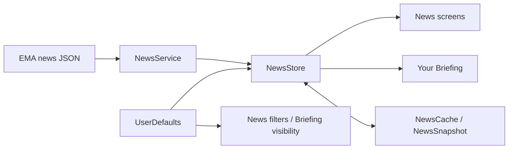
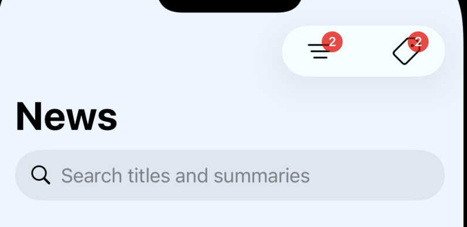
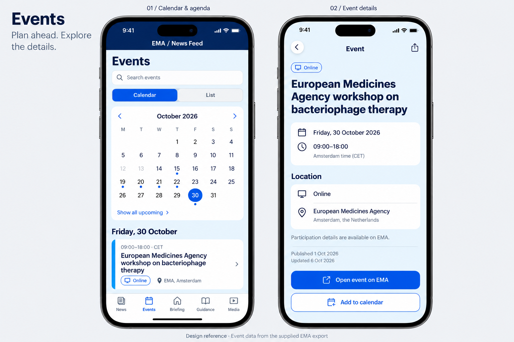
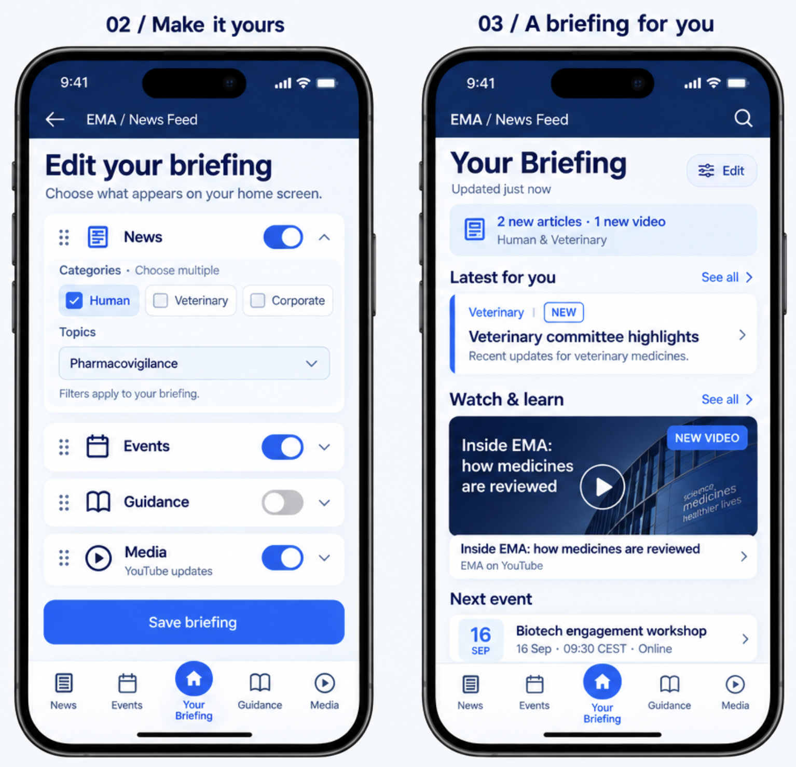
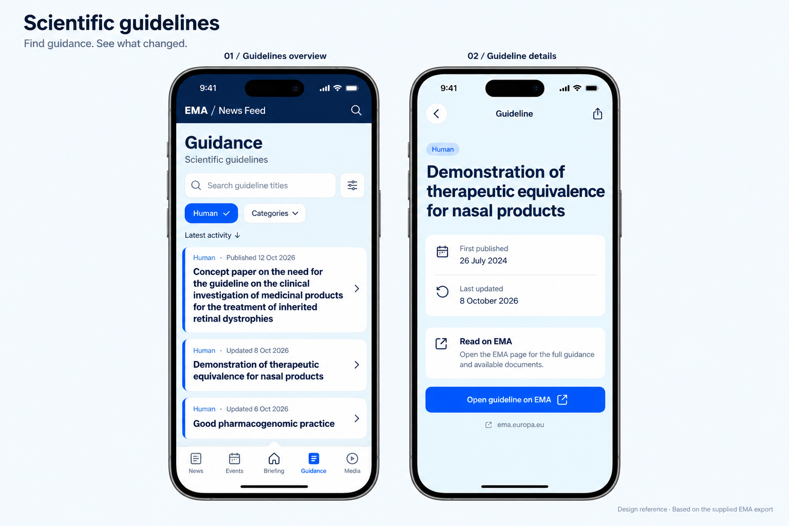
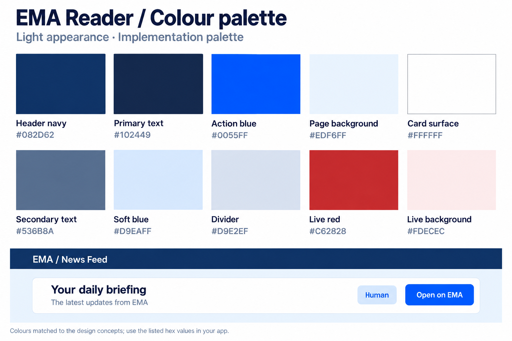

# EMA News Reader Draft App Description

## 1. Intro
EMA News Reader is an independent native iPhone app that makes public European Medicines Agency information easier to browse.

Its core journey is: open a relevant briefing → find an announcement or upcoming event → inspect available metadata → follow the original source.

Intended audiences include people following medicines regulation, regulatory affairs professionals, students, and interested readers. These are proposed audience groups, not results of user research. The app organizes published information; it does not provide clinical recommendations or replace original regulatory documents.

## 2. Data Sources
### 2.1 General Info
The app uses: https://www.ema.europa.eu/en/scientific-guidelines/download-website-data-json-data-format

From the EMA Homepage:
> [!QUOTE]
> You can download structured JSON data files to automatically access and retrieve up-to-date information and documents from the European Medicines Agency’s (EMA) website. These data files specifically target use via automated systems. Examples of the information available include data on medicines, guidelines, and documents along with their translations, where available. The JSON data files are updated twice a day.
> 

### 2.2 Sources
The JSON files used in the app are publicly available on the EMA homepage.

| Area                           | Source                                                                                                                       |
| ------------------------------ | ---------------------------------------------------------------------------------------------------------------------------- |
| News                           | [News JSON](https://www.ema.europa.eu/en/documents/report/news-json-report_en.json)                                          |
| Events                         | [Events JSON](https://www.ema.europa.eu/en/documents/report/events-json-report_en.json)                                      |
| Guidance / general information | [Scientific Guidelines JSON](https://www.ema.europa.eu/en/documents/report/scientific-guidelines-output-json-report_en.json) |
| Media                          | [EMA YouTube channel](https://www.youtube.com/@emainfo)                                                                      |

EMA describes the exports and their update schedule in its [JSON data documentation](https://www.ema.europa.eu/en/scientific-guidelines/download-website-data-json-data-format). Export scheduling is separate from the app's current startup/manual refresh behavior. 

## 3. Architecture and storage
These preferences and reading indicators are local to the app installation. There is no account or cross-device synchronization. The current source contains no analytics integration. Network requests go to EMA for the feed; following an original-article link opens its destination website.

Offline access: Previously saved feed entries and their summaries remain available when a download fails.

General ideas:
- Switching tabs does not itself trigger another download once articles have loaded.
- I want the app to try loading new data whenever it is opened again

**What happens if a download fails?**
Previously loaded or restored news stays available. The News tab reports the failure and allows another refresh. **Last checked** records the most recent successful download, rather than the most recent attempt or EMA's own publication time. Without a saved snapshot, an unsuccessful first download leaves the app without articles and offers a retry. If news loads successfully but saving fails, the News tab warns that the latest changes could not be saved for offline use.

Open questions:
- How is the data downloaded and stored?
- Can the app just store the downloaded json and use that? EMA includes a timestamp in the json file.
- Can I reuse the loader for all? Like for News, Events, Guidance? the only difference is the download link

Design idea with regards to data loading:

`ContentView` creates a shared observable `NewsStore` on the main actor and requests initial loading. `NewsService` uses URLSession, validates HTTP success, decodes records, sorts and deduplicates. `NewsFeed`/`NewsRecord` own metadata interpretation, filtering and update comparisons. Views present that state and report read actions.

`NewsCache` is an actor reading/writing a Codable snapshot atomically in Application Support. `NewsStore` queues saves in order so older work cannot overwrite later state. UserDefaults stores reading URLs and view preferences. Feed state and preferences have different lifetimes and should not be collapsed into one undifferentiated settings object.

The store accepts injected loading, clock, preferences and cache dependencies. Tests can use local data and isolated state; previews avoid live downloads and persistent app state. Keep these seams when refactoring.

## 4. Functionality
### 4.1 Overview
The app should have those 5 tabs for now:
- News
- Events
- Your Briefing (Briefing is the central home destination)
- Scientific Guidlines
- Media

The five-tab structure is established. Your Briefing is the central home destination; it shares data and read/change state with the other tabs. Changing tabs does not itself reload an already-loaded feed.

### 4.2 News
#### Overview
The data comes from the EN json file EMA publishes on their website: https://www.ema.europa.eu/en/documents/report/news-json-report_en.json

The JSON has the following fields:

| Name                      | value                              | datatype in app       |
| ------------------------- | ---------------------------------- | --------------------- |
| title                     | "Meeting highlights"               | keep as string        |
| press_release             | "Yes" or "No"                      | turn into Bool        |
| related_medicine_referral | "" or "Stemyca;Bovilis Lumpyvax"   | ?                     |
| categories                | "Human;Veterinary"                 | turn into array       |
| topics                    | "Clinical trials;Medicines"        | turn into array       |
| news_summary              | "Technical and regulatory support" | keep as string        |
| first_published_date      | "08/10/2026"                       | turn into date        |
| last_updated_date         | "" or "08/10/2026"                 | nil or turn into date |
| news_url                  | url as string                      | turn into url         |

Split category/topic values, trim whitespace and discard empty entries; menu values are deduplicated across records.

The news feed shows as cards that contain:
- title
- first_published_date
- categories
- topics
- badges (app generated)

If you click on a card, you see a more detailed summary page including all information
- related_medicine_referral: find out if I can use that field to link to the referral? it always seems to link to the following in the original: https://www.ema.europa.eu/en/medicines/veterinary/EPAR/bovilis-lumpyvax

#### Search and Filters
**Search** matches text in article titles and summaries. Leading and trailing whitespace is ignored, and matching uses localized, case- and diacritic-insensitive text comparison.
- **Categories** and **Topics** come from values present in the loaded feed (Split category/topic values, trim whitespace and discard empty entries; menu values are deduplicated across records). Each menu supports multiple selections. 
- **Match any selected** includes articles containing at least one selected value in that group. This is the default.
- **Match all selected** includes articles containing every selected value in that group.
- An empty selection leaves that group unrestricted.
- clear categories/topics clears all selected values

Search, category filters, and topic filters combine: an article must satisfy **all three groups** to appear.

For example, selecting **Human** and **Veterinary** in Categories with **Match any selected** includes articles tagged with either category. Switching to **Match all selected** requires both. Adding a topic selection further narrows those results.

The red number on each filter button shows how many values are selected in that menu. It is not an article count. The new-article count above the list counts NEW articles within the current search and filter results.

Use **Clear categories** and **Clear topics** in their respective menus to remove selections, and clear the search field to remove the text query. There is currently no single reset-all control. Category/topic selections and their matching modes persist between launches; search text does not.

If results look unexpectedly empty, check saved filters. A previously selected category or topic can remain selected even if it is absent from the current feed; clearing that filter group removes it.

Search and the two filter groups combine with AND; each group independently supports any/all selections. Menus remain open for multiple selections. Red filter badges count selected values, not articles. The new-result count reflects current News search/filter results. Read is local opening history; NEW is the latest observed addition batch; UPDATED is an unseen change to an existing URL. First download has no comparison badges. A URL change can appear as removal plus addition. Filters do not clear badge state. Export timestamps do not create update badges, and changes only to unexported webpage content are not detectable.

#### Badges
Badges describe the app's local reading history and comparisons between downloaded snapshots.

| Badge   | Meaning                                                                                                                                                            | When it clears                                                                                                                         |
| ------- | ------------------------------------------------------------------------------------------------------------------------------------------------------------------ | -------------------------------------------------------------------------------------------------------------------------------------- |
| Read    | You have opened this article's detail screen from News or Your Briefing. Opening the original website is not required.                                             | Read status is saved locally; there is currently no mark-as-unread control.                                                            |
| NEW     | The article URL was absent from the previous loaded snapshot and has not already been marked read.                                                                 | Opening its details clears the badge. A later download that finds another batch of added URLs replaces the previous NEW batch.         |
| UPDATED | An existing URL has changed since the previous snapshot: title, summary, categories, topics, first publication date, or a newly available/later valid update date. | Opening the current downloaded version clears the badge. It otherwise persists across refreshes while the article remains in the feed. |

**NEW does not mean “published today” or simply “unread.”** On the first successful download without an earlier snapshot, no articles are marked NEW or UPDATED because there is nothing to compare against. A saved snapshot provides the comparison baseline on later launches.

If a refresh adds no new URLs, existing NEW badges remain for articles still in the feed that have not been read. If a refresh does add URLs, only unread articles in that latest addition batch receive NEW badges. Articles that disappear from the feed lose their NEW and UPDATED tracking.

An article can display **Read** and **UPDATED** together: you opened it previously, but the app has since detected a change. The update date in article details is supplied by EMA; an UPDATED badge is the app's own change detection, so the two do not always appear together.

### 4.3 Events
Show only future events per default. The user can switch the settings to also show older events, but the default is to show only events today or in the future. The original intent is events whose start is in the future, ordered nearest first. 

Overview:
- Switch between **Calendar** and **List**.
- Dots mark event dates; selecting a date shows its events below.
- Cards show the title, time, online status and location.
- **Briefing** stays in the centre of the five tabs.

Event details:
- Full title, schedule and location.
- Publication and update dates.
- **Open event on EMA** for participation information.
- **Add to calendar** as a proposed app feature.

Your export has **no summaries, categories or topics**, so I’ve omitted those. A “Live broadcast” badge can appear when its flag is true, without implying the event is live right now. One important detail: the JSON’s schedule text contains **no explicit time zone**. For this example, I verified **Amsterdam time (CET)** on the [EMA event page](https://www.ema.europa.eu/en/events/european-medicines-agency-workshop-bacteriophage-therapy). Multi-day events should show individual session times when provided.

The JSON has the following fields:

| Name                 | value                                                                                                                                  | datatype in app |
| -------------------- | -------------------------------------------------------------------------------------------------------------------------------------- | --------------- |
| title                | "Meeting highlights"                                                                                                                   | keep as string  |
| date_start_end_dates | "Thu, Oct 15 2026, 8:30am - 5:15pm"; "Fri, Dec 9 2022, All day"; "Mon, Oct 12 - Thu, Oct 15 2026, All day"; "Wed, Oct 7 2026, 4 - 5pm" | convert to date |
| live_broadcast       | "No" or "Yes"                                                                                                                          | convert to Bool |
| online               | "No" or "Yes"                                                                                                                          | convert to Bool |
| location             | "European Medicines Agency, Amsterdam, the Netherlands"                                                                                | keep as string  |
| first_published_date | "23/09/2022"                                                                                                                           | convert to date |
| last_updated_date    | "" or "13/10/2026"                                                                                                                     | convert to date |
| event_url            | url as string                                                                                                                          | convert to URL  |

Questions:
- how can I convert the date_stat_end_dates to real dates I can use in the app?

Ideas for further releases:
- the user can add events to her/his calendar

### 4.4 Your Briefing
I like the briefing to be adjustable based on what the user wants to see. These preferences should be stored and survive opening and closing the app.

#### Edit Briefing
Its Save/Cancel editor copies saved state into a draft and commits only on Save. News/Events/Guidance filters must remain unchanged when Briefing preferences change. Persist draft changes only on Save.

Ideas:
- the briefing could consist of section the user can choose to turn on and off, like News, Events,.... and also reorder

### 4.5 Scientific Guidelines
The JSON has the following fields:

| Name                 | value                                         | datatype in app       |
| -------------------- | --------------------------------------------- | --------------------- |
| title                | "Concept paper on the need for the guideline" | keep as string        |
| categories           | "Human;Veterinary"                            | turn into array       |
| first_published_date | "08/10/2026"                                  | turn into date        |
| last_updated_date    | "" or "08/10/2026"                            | nil or turn into date |
| url                  | url as string                                 | turn into url         |

The design could look like this:

### 4.6 Media
Youtube: https://www.youtube.com/@emainfo
- EMA publishes videos and shorts
- EMA also goes live sometimes (can I include an alert in the app when that happens?)

EMA also has a podcast (https://www.ema.europa.eu/en/news-events/podcast-inside-ema). At first it might be better to just include links to the platforms where you can watch it. 

Question:
- is integration of the podcast in the app possible?

|Option|Experience|Best fit|
|---|---|---|
|**1. Simple media hub**|Videos, Shorts and podcast platform links on one page|Your first version|
|**2. Watch & Listen**|Separate sections for video and podcast content|A clearer layout as content grows|
|**3. Integrated podcast**|Episode list, in-app playback and a persistent mini-player|A later enhancement|

**My suggestion:** use **Option 2’s layout**, initially with external podcast links. Later, add Option 3’s player inside the Listen section.

**Can the podcast play inside the app?**
**Yes**, provided we verify a usable podcast feed containing direct audio URLs. Native playback can support background listening and AirPlay. I found a candidate RSS feed, but couldn’t verify it directly, so that remains an implementation check. [Apple media playback documentation](https://developer.apple.com/documentation/avfoundation/configuring-your-app-for-media-playback)
For the first version, Apple Podcasts and Spotify links are practical—EMA itself links to both. [EMA’s podcast announcement](https://www.linkedin.com/posts/european-medicines-agency_is-the-next-pandemica-matter-of-when-instead-activity-7406280481782153216-Cy-7)

**Can the app alert me when EMA goes live?**
**Yes, with two levels:**
- **While using the app:** check YouTube’s live status and show a “Live now” banner. YouTube supports finding active and upcoming broadcasts. [YouTube documentation](https://developers.google.com/youtube/v3/docs/search/list)
- **While the app is closed:** use a small server to monitor broadcasts and send opt-in push notifications. Phone-only background checks won’t provide dependable timing; notification delivery also isn’t guaranteed. [Apple notification documentation](https://developer.apple.com/library/archive/documentation/NetworkingInternet/Conceptual/RemoteNotificationsPG/CreatingtheNotificationPayload.html)
I’d keep **live alerts**, **new-video alerts** and **new-podcast alerts** as separate preferences.

_The drawings use illustrative thumbnails, durations and live states. The first option’s alert helper text should say “Get notified when EMA goes live.”_

## 5. UI Design
### 5.1 Overview
The original visual direction is editorial: navy header, pale-blue backgrounds, rounded white cards, clear typography, blue accents, category/topic labels, and visible change indicators. This is a design brief, not a claim that every styling detail has shipped. Layouts should adapt to compact and wide devices, larger text, light/dark appearance, VoiceOver, and comfortable touch targets. Avoid fixed screenshot-sized layouts.

### 5.2 Colors
Use these hex values as the source of truth; the preview card is illustrative.

|Colour|Hex|Use|
|---|---|---|
|Header navy|`#082D62`|Top header|
|Primary text|`#102449`|Titles and body text|
|Action blue|`#0055FF`|Buttons, links, selected tabs|
|Page background|`#EDF6FF`|Screen background|
|Card surface|`#FFFFFF`|Cards and search fields|
|Secondary text|`#536B8A`|Dates, topics, supporting text|
|Soft blue|`#D9EAFF`|Category chips, update banners|
|Divider|`#D9E2EF`|Borders and separators|
|Live red|`#C62828`|Live indicator|
|Live background|`#FDECEC`|Live banner background|

### 5.3 Fonts
Use **SF Pro through SwiftUI’s default system font**. You don’t need to download or bundle it. Semantic text styles let the interface adapt to the user’s preferred text size. [Apple font guidance](https://developer.apple.com/documentation/technologyoverviews/fonts)

| Element               | SwiftUI styling                      | Default size¹  |
| --------------------- | ------------------------------------ | -------------- |
| Screen title — “News” | `.font(.largeTitle.bold())`          | 34 pt          |
| Detail article title  | `.font(.title.bold())`               | 28 pt          |
| Section heading       | `.font(.title2.bold())`              | 22 pt          |
| Card title            | `.font(.headline)`                   | 17 pt          |
| Summary/body          | `.font(.body)`                       | 17 pt          |
| Primary button        | `.font(.headline)`                   | 17 pt          |
| Dates and topics      | `.font(.subheadline)`                | 15 pt          |
| Category chips        | `.font(.caption.weight(.medium))`    | 12 pt          |
| NEW badge             | `.font(.caption2.weight(.semibold))` | 11 pt          |
| Tab labels            | Let native `TabView` handle them     | System-managed |

¹ Reference sizes at the standard text setting; allow them to scale.

### 5.4 SF Symbols
These are the symbols used:

**Bottom navigation**

|Tab|Symbol|Selected variant|
|---|---|---|
|News|`newspaper`|`newspaper.fill`|
|Events|`calendar`|Same symbol, blue tint|
|Briefing|`house`|`house.fill`|
|Guidance|`book`|`book.fill`|
|Media|`play.circle`|`play.circle.fill`|
**Controls and metadata**

|Purpose|Symbol|
|---|---|
|Search|`magnifyingglass`|
|Filters / customise briefing|`slider.horizontal.3`|
|Back / open details|`chevron.left` / `chevron.right`|
|Dropdown|`chevron.down`|
|Selected category|`checkmark`|
|Alerts|`bell` / `bell.fill`|
|Open external page|`arrow.up.right.square`|
|Share|`square.and.arrow.up`|
|Time|`clock`|
|Location|`mappin.and.ellipse`|
|Online event|`video`|
|Add to calendar|`calendar.badge.plus`|
|Refresh / updated|`arrow.clockwise`|
|Reorder sections|`line.3.horizontal`|

**Media controls**

|Purpose|Symbol|
|---|---|
|Podcast / listen|`headphones`|
|Play / pause|`play.fill` / `pause.fill`|
|Skip back / forward|`gobackward.15` / `goforward.15`|
|Broadcast|`dot.radiowaves.left.and.right`|
|Playback speed|`speedometer`|
|Sleep timer|`moon`|
|More options|`ellipsis`|

Use **regular-weight icons** for metadata and **medium or semibold** for controls. Native tab bars should manage their own sizing. SF Symbols are designed to align with the system font; check availability against your deployment target in the SF Symbols app. [Apple symbol guidance](https://developer.apple.com/design/human-interface-guidelines/sf-symbols)

**YouTube, Spotify and Apple Podcasts branding:** use official brand assets or plain text labels—SF Symbols aren’t substitutes for their logos.

## 6. Reliability, privacy and boundaries
Cache restoration precedes refresh. Failed/cancelled downloads preserve existing content and the last successful timestamp. Cache-write failure is a separate warning after a successful download. A corrupt cache does not prevent a network attempt. Asynchronous saves must complete before their state is guaranteed after process termination.

Current preferences, read history and snapshots are local. There are no accounts, cross-device sync, analytics integrations or notification systems in current source. Following a source link opens its destination; third-party sites have their own behavior.

Questions:
- if I want to embed youtube videos how can I do that? Do I need to comply to GDPR?

Example: EMA has this on their website:

## 7. Other Features

Ideas:
- the app should be usable for people with disabilities, so it is important to me that I learn how to implement those features